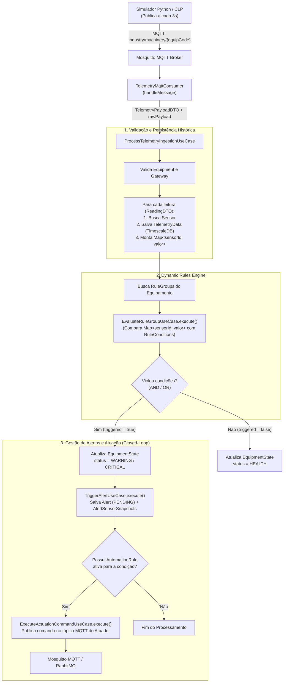
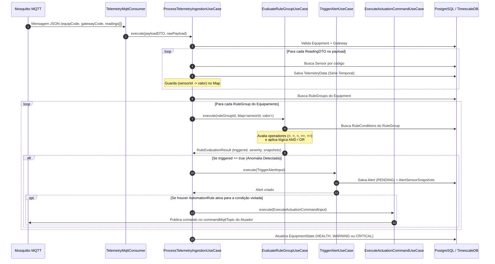
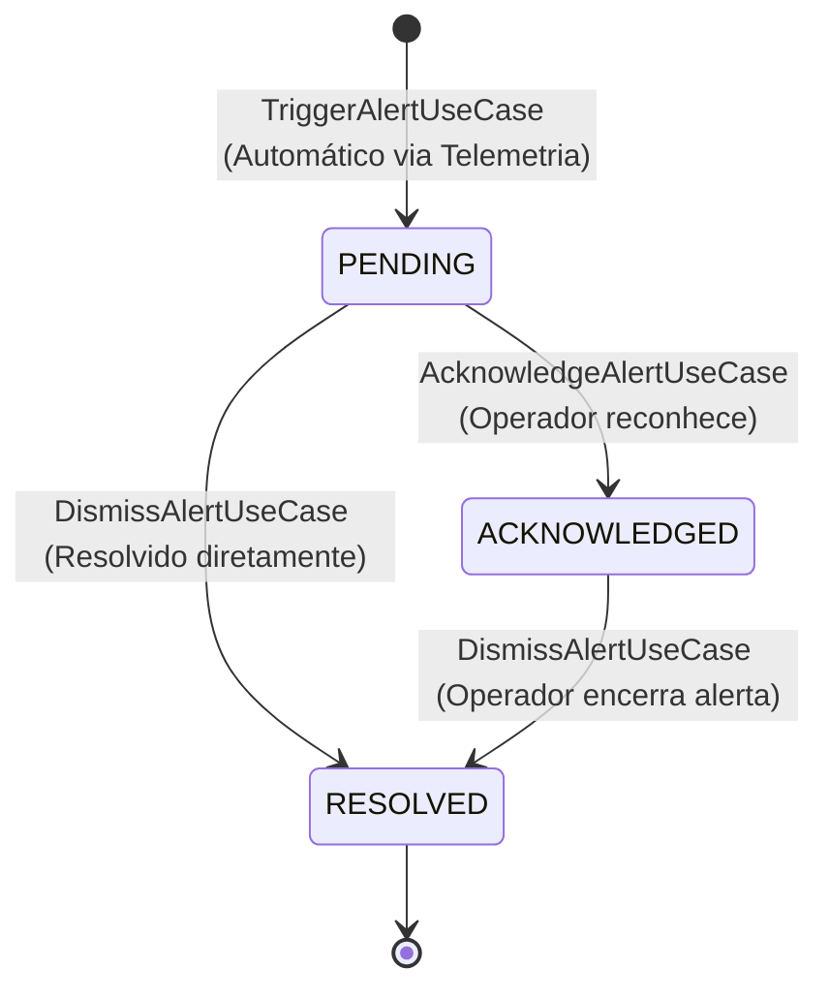

# Fluxo de Ingestão de Telemetria, Motor de Regras, Alertas e Atuação

Este documento detalha o fluxo completo de ponta a ponta (End-to-End) desde a chegada do pacote MQTT enviado pelo simulador/equipamento até a avaliação de regras dinâmicas, geração de alertas e disparo de comandos para atuadores.

---

## 1. Em que momento o `EvaluateRuleGroupUseCase` é acionado?

O ponto de encontro entre os dados que chegam do MQTT e o motor de regras é **dentro (ou logo após) do `ProcessTelemetryIngestionUseCase`**.

Repare no que o `ProcessTelemetryIngestionUseCase` já faz hoje nas linhas 43–66:
1. Ele percorre cada leitura (`ReadingDTO`) do pacote MQTT, busca o `Sensor` e salva no TimescaleDB (`telemetry_data`).
2. Logo em seguida, ele atualiza a tabela `equipment_state` definindo o `HealthStatus` (`HEALTH`, `WARNING`, `CRITICAL`).

**É exatamente entre o passo 1 e o passo 2 que o `EvaluateRuleGroupUseCase` entra!**
Quando o loop de leituras termina, nós já temos em mãos:
- O `Equipment` (`equipmentId`)
- Todos os valores recém-lidos mapeados por sensor: `Map<UUID, BigDecimal> sensorReadings`

Nesse exato instante:
1. Buscamos todos os grupos de regras daquele equipamento (`ruleGroupRepository.findByEquipmentId(equipmentId)`).
2. Para cada `RuleGroup` ativo, chamamos o **`EvaluateRuleGroupUseCase.execute(...)`** passando o `Map<UUID, BigDecimal>` que acabou de chegar no payload MQTT.
3. **Se `result.triggered() == false`**: o equipamento continua saudável (`HealthStatus.HEALTH`).
4. **Se `result.triggered() == true`**:
   - O status de saúde do equipamento (`equipment_state`) passa para `WARNING` ou `CRITICAL` (conforme `result.calculatedSeverity()`).
   - Chamamos o **`TriggerAlertUseCase`** para gravar o `Alert` + `AlertSensorSnapshot` no banco.
   - Se houver uma `AutomationRule` vinculada à condição violada, chamamos o **`ExecuteActuationCommandUseCase`** para enviar o comando ao atuador via MQTT.

---

## 2. Diagrama de Fluxo Geral (Flowchart)

---

## 3. Diagrama de Sequência Detalhado (Sequence Diagram)

---

## 4. Ciclo de Vida do Alerta (Operador Humano)

Depois que o `TriggerAlertUseCase` cria o alerta com status `PENDING`, o operador interage com ele via API REST:

